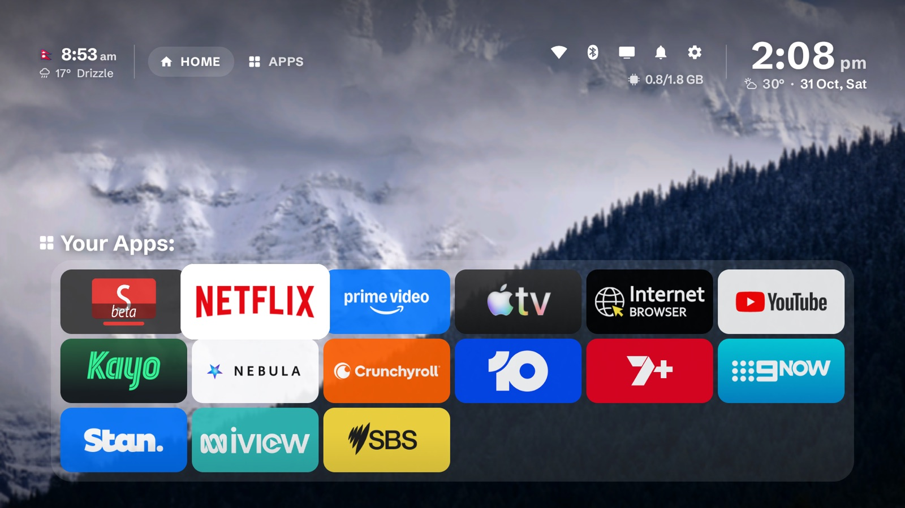
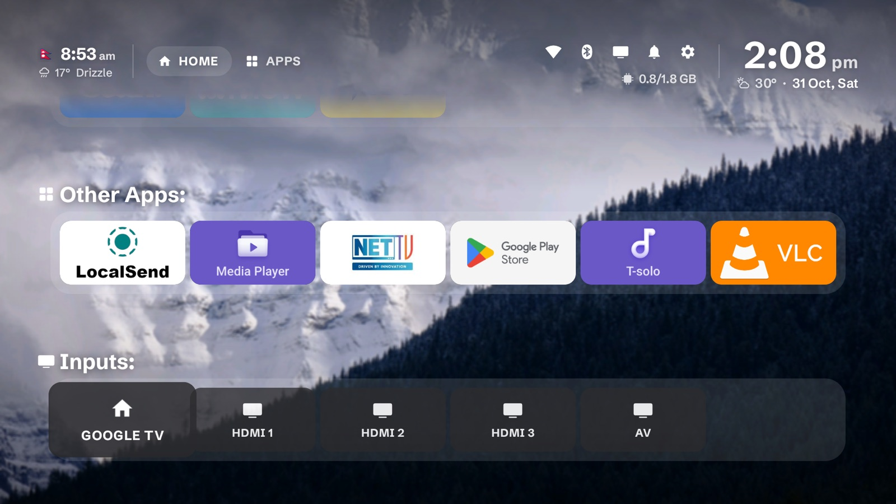
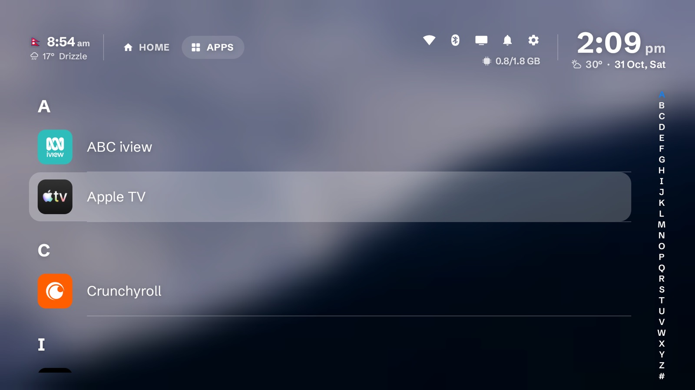
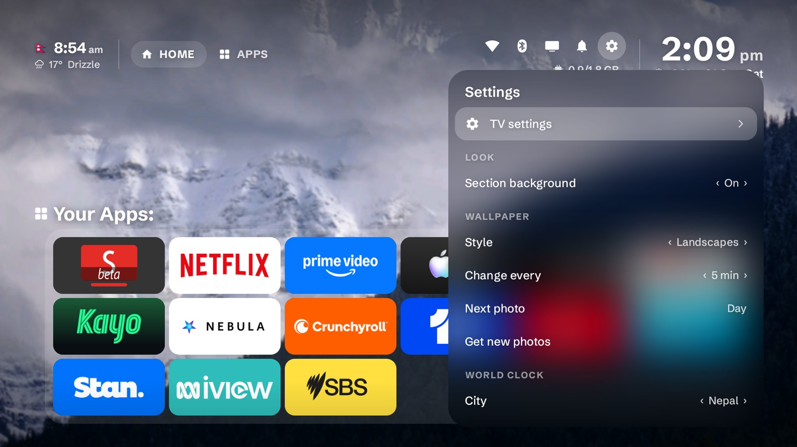

# BEESH Launcher

A calm home screen for Android TV and Google TV. Your apps, the time and weather where you are and
where your people are, and a landscape that changes with the time of day.

No ads, no rows of recommendations, no account.



| Other apps and inputs | All apps | Settings |
|---|---|---|
|  |  |  |

## Features

- **Clock on the right** of the menu bar, with the weather where the TV is and the date, and a world
  clock on the left with its flag and weather. The middle stays clear for the photo.
- **Your Apps** first, in the order you want, then **Other Apps** A–Z, then **Inputs**: Google TV,
  HDMI 1–4 and AV. Rename any input, or keep the names set in the TV's settings.
- **Five layouts** for Home, under **Settings → Look**:
  - **Tiles**: the 16:9 grid, with adjustable spacing across and down.
  - **Pills**: round icon and name on light frosted glass.
  - **Rows**: one row per section that scrolls sideways.
  - **Metro**: flat coloured tiles in mixed sizes that touch, like the Windows 8 Start screen.
  - **Dock**: your apps in a glass bar that magnifies as you move, like the macOS Dock. When they
    don't all fit it pages sideways, with dots under it; Other Apps and Inputs sit below.
- **Focus like the Dock, in every layout**: the selected tile grows, the two beside it grow a little,
  and the rest of its row slides left and right to make room; nothing else moves. Its name shows in a
  small frosted pill above it, as in the macOS Dock. Scrolling glides on a
  spring, so holding the D-pad down moves smoothly instead of in jumps.
- **Four icon sizes** (Tiny, Small, Medium, Large), plus a separate **Dock size**. Every layout
  remembers its own size, section background and blur, so switching back finds it as you left it.
- **Section backgrounds** of frosted glass, with the blur Light, Medium or Hard.
- **Updates itself** from this repo's GitHub releases: a new version downloads in the background and
  an **Update** button appears next to Home / Apps. **Settings → Updates** checks on demand.
- **Every app** one tab over, in a full-screen A–Z list.
- **Dynamic wallpapers** from wallhaven.cc that follow the time of day (morning, day, evening, night),
  in three styles: landscapes, cityscapes or the current season.
- **Wi-Fi, Bluetooth, Inputs and Notifications** panels: see your network and nearby ones, which
  devices are connected, switch HDMI, and read or clear notifications without leaving Home.
- **BEESH TV Suite**: setup offers the other BEESH apps, for now
  [BEESH Browser](https://github.com/bishwofic/BeeshTVBrowser). Open **BEESH TV Suite** to see them, each
  ticked; untick any you don't want and choose **Install**. Each comes from its own repo's newest release
  and the TV asks once to confirm. It's also under **Settings → BEESH TV Suite**.
- **Pairs with BEESH Browser**: the browser's home page shows the same weather, and its frosted
  background is your Home screen, blurred.
- **Keeps the Home button** on Google TV, which otherwise hands it back to its own home screen.
- Small and quick: about 2 MB, plain Android, nothing running in the background except the
  notification listener and the Home button service.

## Install

You need a computer with `adb` on the same Wi-Fi as the TV (`brew install android-platform-tools` on
a Mac). Works on Android TV and Google TV running Android 11 or newer.

1. On the TV, open **Settings → System → About** and press OK on **Android TV OS build** seven times.
   Go back to **Settings → System → Developer options** and turn on **USB debugging**.
2. Find the TV's IP address in **Settings → Network & Internet** (select your Wi-Fi network).
3. Download this repo (or just `dist/BeeshTV-Launcher-3.1.apk` and `install.sh`) and run:

   ```bash
   ./install.sh 192.168.1.20
   ```

4. Accept **Allow debugging?** on the TV. Press Home.

`install.sh` installs the whole of BEESH TV Suite. It installs the launcher APK, makes BeeshTV the
Home app, switches off Google TV's own home screen (nothing is uninstalled), grants every permission
the launcher uses (including installing its own updates), turns on *BEESH Home button*, and sets the
TV's **Private DNS** to AdGuard (`dns.adguard-dns.com`), which blocks ads and trackers in every app.
Then it downloads the newest **BEESH Browser** from GitHub, installs it, makes it the TV's browser and
lets it use the microphone for voice typing. Change or turn off Private DNS any time under
**Settings → Network & Internet**. For the launcher alone: `./install.sh 192.168.1.20 --no-browser`.

To go back to the stock home screen (and automatic Private DNS): `./install.sh 192.168.1.20 --undo`.

### Installing just the APK

Download `BeeshTV-Launcher-3.1.apk` from the [latest release](https://github.com/bishwofic/BeeshTVLauncher/releases/latest),
copy it to the TV (a USB stick, LocalSend, or a downloader app) and open it, then open
**BEESH Launcher** from the TV's apps. Setup opens by itself and asks for what it needs, one at a
time: location (for local weather; the time zone always comes from the TV), notification access (for
the bell), Bluetooth (for the paired devices panel), to become the Home app, on Google TV **Keep the
Home button**, and permission to install updates. Then **BEESH TV Suite** offers BEESH Browser, ticked;
**Install BEESH Browser** fetches it. **Open Launcher Settings** at the bottom goes straight to the
layouts.

Google TV keeps its own home screen on the Home button even after you pick another one. **Keep the
Home button** turns on a small accessibility service, *BEESH Home button*, that sends Home to
BeeshTV instead. It only listens for the Home key and reads nothing on screen. If the TV says the
setting is restricted, open **App info** for BeeshTV, allow restricted settings, and try again.

On TCL-made TVs the system won't start that service again after a restart, so Google TV's home can
come back after one. For a fix that lasts, use a computer once (below) or `install.sh`, which
switches Google TV's home screen off.

### Doing it by hand

```bash
adb connect 192.168.1.20:5555
adb install BeeshTV-Launcher-3.1.apk
adb shell cmd package set-home-activity com.beeshtv.home/.MainActivity
```

Google TV has no setting for the default home app and takes the Home button back from any other
launcher, so the stock one has to be switched off. This only disables it; nothing is uninstalled:

```bash
adb shell pm disable-user --user 0 com.google.android.apps.tv.launcherx
adb shell pm disable-user --user 0 com.google.android.tungsten.setupwraith
```

Turn them back on with `adb shell pm enable <package>`.

The Wi-Fi panel shows network names only when the launcher has location permission and Location
is on, the bell needs notification access, the Bluetooth panel needs Bluetooth access, and updates
need permission to install apps.
`install.sh` sets them all; by hand:

```bash
adb shell pm grant com.beeshtv.home android.permission.ACCESS_FINE_LOCATION
adb shell pm grant com.beeshtv.home android.permission.BLUETOOTH_CONNECT
adb shell cmd location set-location-enabled true
adb shell cmd notification allow_listener com.beeshtv.home/com.beeshtv.home.NotificationsService
adb shell appops set com.beeshtv.home REQUEST_INSTALL_PACKAGES allow
```

## Using it

| Remote | |
|---|---|
| OK | Open the app |
| Hold OK | On an app: move it, move it between Your Apps and Other Apps, uninstall it, app info. On an input: rename it |
| Menu | Inputs |
| Back | Back to Home |
| Left / Right in All apps | Jump to the previous / next letter |

**Settings** (the gear, top right) is a list of pages:

| Page | |
|---|---|
| Look | Layout, icon size (and Dock size), spacing for Tiles, section background and its blur |
| Wallpaper | Style, how often it changes, next photo, fetch new photos |
| World clock | The city on the left of the menu bar, or off |
| Updates | Installed version, check now, download and install, automatic downloads on or off |
| Permissions | The setup list, with what's still missing |
| About | Version, this TV, credits |

## Updates

New versions are published as [GitHub releases](https://github.com/bishwofic/BeeshTVLauncher/releases).
The launcher looks for one every six hours, downloads it in the background, and shows **Update** next
to Home / Apps when it's ready. The TV asks you to confirm before it installs.

To publish one: bump `android:versionCode` and `android:versionName` in
`launcher/AndroidManifest.xml`, then run `./release.sh`, which builds the APK and publishes it as
release `v<versionName>` with the GitHub CLI. Keep `launcher/debug.keystore`: an update signed with a
different key won't install over the old one.

## Build it yourself

No Gradle, just the SDK command-line tools:

```bash
brew install openjdk@17 android-commandlinetools
yes | JAVA_HOME=/opt/homebrew/opt/openjdk@17 sdkmanager \
  --sdk_root=/opt/homebrew/share/android-commandlinetools "platforms;android-34" "build-tools;34.0.0"

launcher/build.sh                 # builds dist/BeeshTV-Launcher-<version>.apk
launcher/build.sh 192.168.1.20    # builds and installs
```

The default Home apps, hidden apps and city list are at the top of
`launcher/src/com/beeshtv/home/Prefs.java`.

The APK is signed with `launcher/debug.keystore`, created on the first build (it isn't in the repo).
An update only installs over an older version signed with the same key, so if you build your own,
uninstall the release APK first.

## Clean up a TCL TV (optional)

TCL's Google TVs (the list was made on a TCL Smart TV Pro, Android 14) ship with a viewing tracker
(Samba TV), analytics, promo pop-ups and an app that installs sponsored apps on its own.
`debloat.txt` lists them, one line each with what it does. Comment out anything you use.

```bash
./backup.sh 192.168.1.20     # saves package lists and settings to backup/
./debloat.sh 192.168.1.20    # disables everything in debloat.txt
./restore.sh 192.168.1.20    # puts the TV back the way backup.sh found it
```

Everything is disabled, never uninstalled, so a restore is complete. `install.sh` already sets
Private DNS to AdGuard for ad blocking across every app; by hand:

```bash
adb shell settings put global private_dns_mode hostname
adb shell settings put global private_dns_specifier dns.adguard-dns.com
```

## Credits

- Photos are found through [wallhaven.cc](https://wallhaven.cc) and belong to their photographers.
- Location for the weather comes from the TV itself; without one, from [ipwho.is](https://ipwho.is).
- Weather data by [Open-Meteo.com](https://open-meteo.com) (CC BY 4.0).
- Typeface: [Schibsted Grotesk](https://github.com/schibsted/schibsted-grotesk) by Schibsted (SIL Open Font License).
- Menu bar icons are in the style of Google's Material Symbols (Apache 2.0).
- Input switching is adapted from [tv-home](https://github.com/mihirgupta0900/tv-home) (MIT).

Licences for bundled work are in `launcher/licenses/`.

## License

MIT, see [LICENSE](LICENSE). Made by [Bishwo Bhusal](https://github.com/bishwofic).
